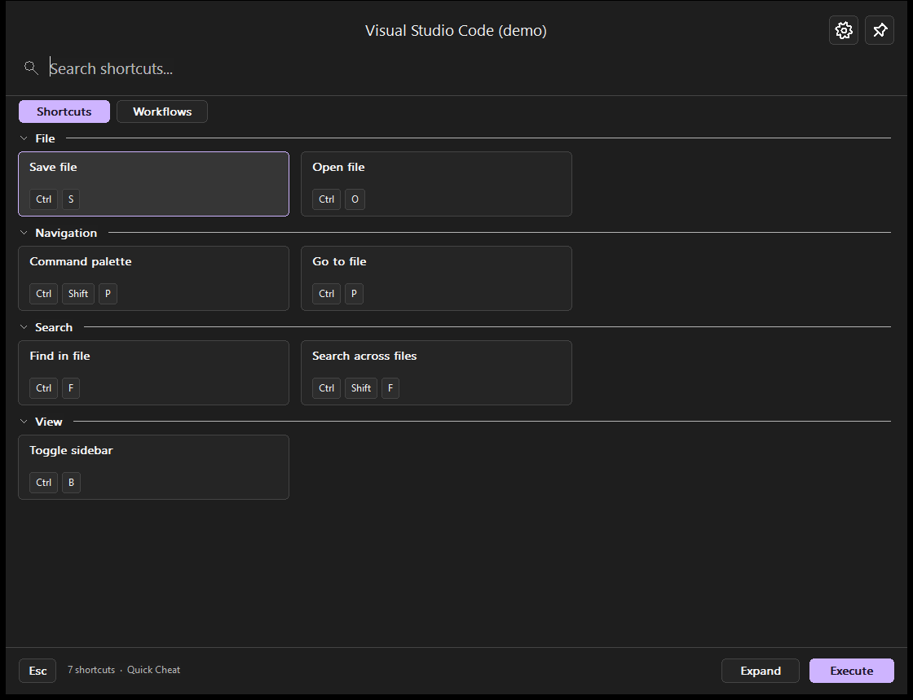
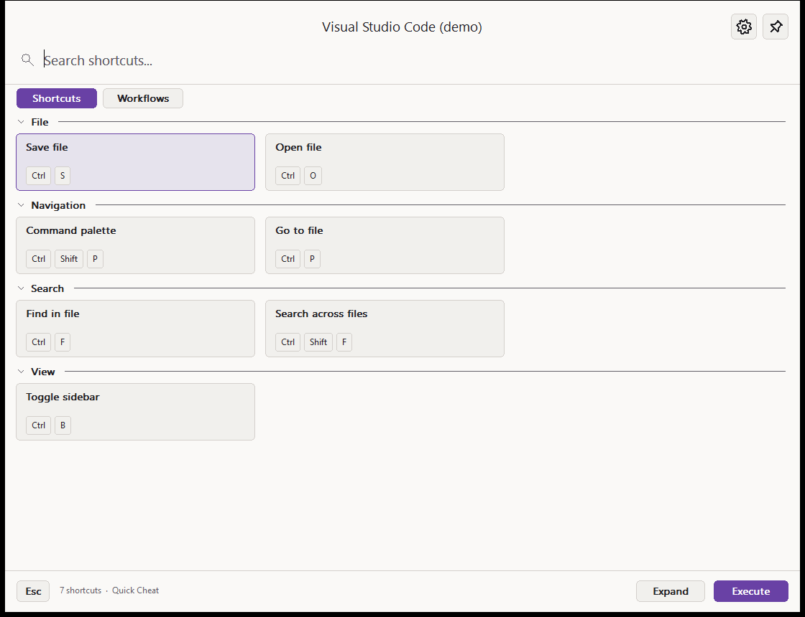
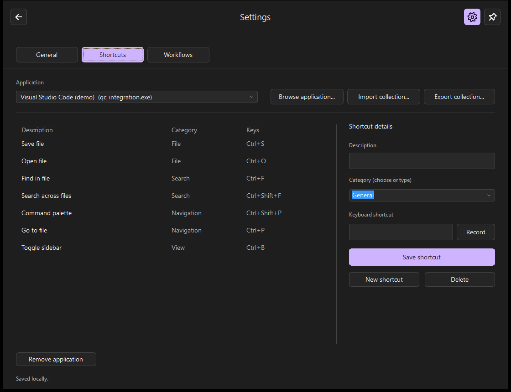
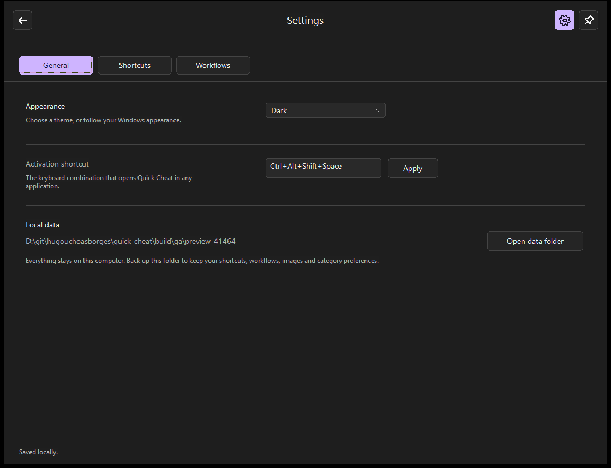
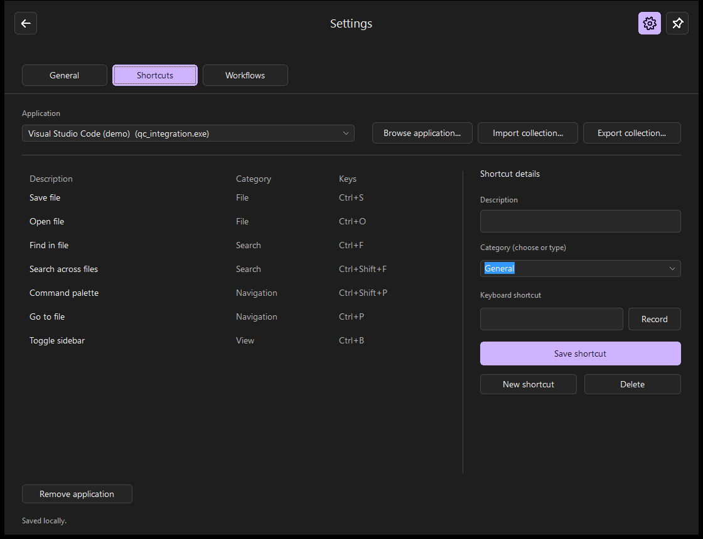
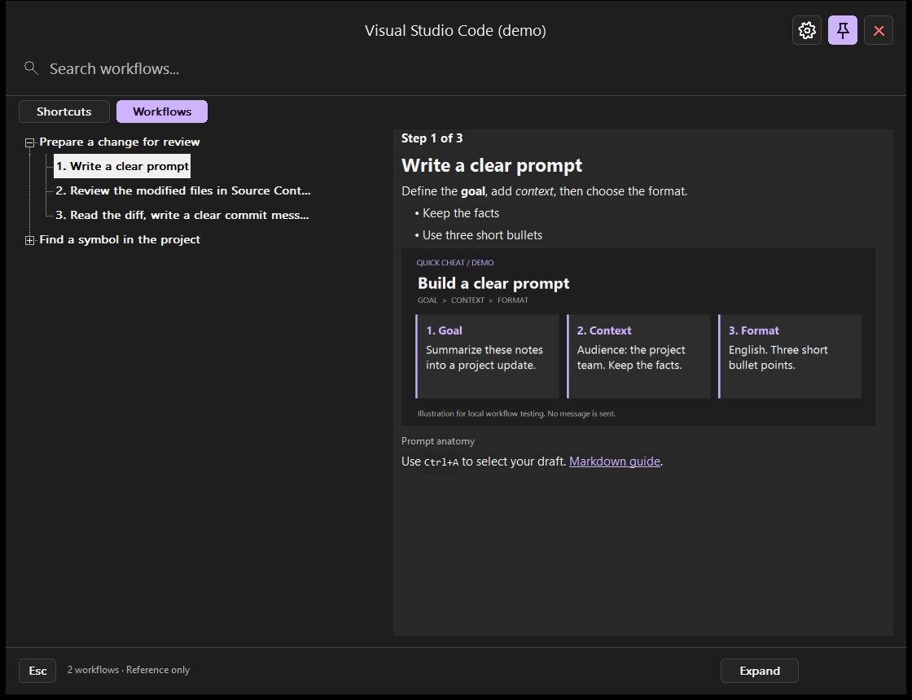
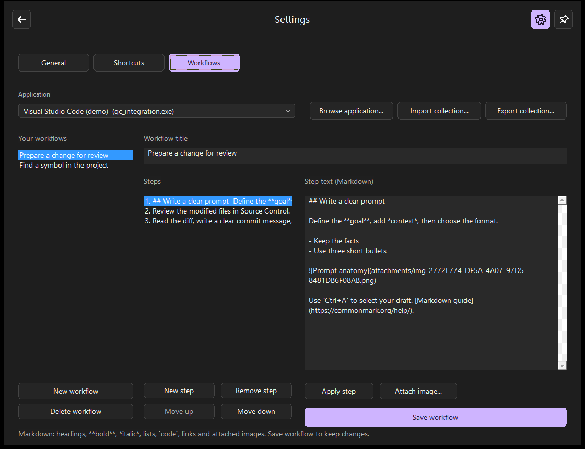
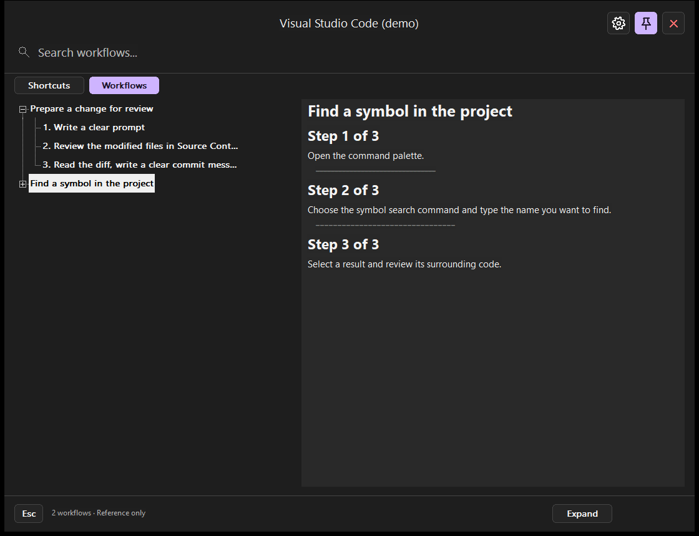

# Quick Cheat

Remember less. Keep your keyboard shortcuts close.

Quick Cheat is a small Windows app that keeps keyboard shortcuts and step-by-step guides close to the application you are using. Find a shortcut, run it deliberately, or follow a workflow with Markdown explanations and images.

Built with C++ and native Windows controls, with a focus on speed and low memory use. Everything stays on your computer. No accounts, telemetry or internet connection required.

## Download

[Download Quick Cheat for Windows x64 — v0.2.0-alpha.8](https://github.com/hugouchoasborges/quick-cheat/releases/tag/v0.2.0-alpha.8)

Download the ZIP, extract it and run `QuickCheat.exe`. No installer or additional runtime is needed. This is an early alpha release.

## A shortcut library for each app

- Open a searchable popup for the current application.
- Organize shortcuts into collapsible categories, remembered for each app.
- Click once to select; double-click, press Enter or click **Execute** to run.
- Add, edit and record shortcuts in the local library.
- Choose **System**, **Light** or **Dark** appearance.
- Pin the popup to keep it open, or let it hide when it loses focus.
- Keep local workflows with ordered steps, Markdown and image attachments.

### Light theme

### Manage your shortcuts

Screenshots were captured from the released app using isolated, fictional demo data. Sample shortcuts and diagrams are illustrative; applications do not come with preloaded profiles. Personal profiles and images are not included in the download.

## Getting started

1. Launch Quick Cheat. It runs in the Windows notification area.
2. Open an application and press **Ctrl+Alt+Space** to show its shortcuts.
3. Open the **gear → Shortcuts** to add descriptions, categories and key combinations.
4. Search or select a shortcut, then double-click it, click **Execute** or press Enter. Press **Esc** to close the popup.

You can also open the library from the tray icon. If the default hotkey is already in use on first launch, Quick Cheat tries **Ctrl+Alt+Shift+Space** and notifies you. Change the activation hotkey in the library. Release held modifier keys before executing a shortcut.

## Settings

Use the **gear** to the left of PIN, or open **Settings...** from the tray menu. Three tabs keep global preferences separate from application content:

- **General:** appearance, activation shortcut and access to your local data folder.
- **Shortcuts:** choose an application, organize categories, and add, edit or record shortcuts.
- **Workflows:** choose an application and manage its guides, ordered steps, Markdown and attached images in the same window.

The application selector is shared by Shortcuts and Workflows. Pending edits require confirmation before switching tabs or applications or closing Settings. Use the gear beside PIN to open Settings in the same main window. Back returns to the library after confirming pending edits. Escape and unpinned focus loss hide the window while retaining the draft.

## Portable collections — 0.3.0-alpha.1 candidate

Share an application's shortcuts and workflows as a single `.quickcheat.json` file, including Markdown and attached PNG images. In **Settings → Shortcuts** or **Workflows**, use **Export collection...** after saving your edits, or **Import collection...** to preview a file.

Choose **Add** to keep existing content and skip exact duplicates, or **Replace** to replace that application's content after confirmation. Other applications and global settings stay unchanged. Each application still has one active profile.

See the [format and limits](docs/collection-format.md) and [candidate acceptance checklist](docs/validation-0.3.0-alpha.1.md). This candidate adds local file sharing; community browsing and voting remain planned.

## Local data

Shortcuts and settings are stored in `%LOCALAPPDATA%\QuickCheat\shortcuts.qc`. The previous save is kept as `shortcuts.qc.bak`. To restore it, exit the app, keep a copy of the current file and replace it with the backup.

Category expansion preferences are saved separately in `ui-state.ini` in the same folder, including when using `--data-dir`. Include this file in backups to preserve the layout.

For separate demo or portable data, launch `QuickCheat.exe --data-dir <directory>`. Only one instance can run per Windows session.

## Current scope

Windows x64 only. Windows 10 1809+ and Windows 11 are the intended API baseline; compatibility has not been verified on every Windows version or monitor setup. Elevated or protected applications may block shortcut execution. Profiles are matched by executable filename, so apps with the same filename share a profile.

Each shortcut contains one key combination. Docks, community sharing, an installer and automatic updates are planned for later consideration.

## Workflows

Create local step-by-step guides for each application. Open **Settings → Workflows** and choose an application using the gear beside PIN. Enter a title, add your steps, reorder them with **Move up / Move down**, and click **Save workflow**. Changes to the step text are included when you save the workflow.

Write step explanations in Markdown: headings, **bold**, *italic*, lists, checklists, quotes, code and links render in the popup. Click **Attach image...** in the step editor to copy a PNG, JPEG, BMP or GIF into your local library and insert its Markdown reference. Save the workflow, then select the step in the popup to see the formatted explanation and image. GIFs use the first frame.

Images stay in `%LOCALAPPDATA%\QuickCheat\attachments`. Back up the entire data folder to preserve them; the `.qc` backup alone contains only text and image references. Removing a reference does not delete the image file. Imports accept up to 10 MiB and 24 megapixels, normalize to PNG up to 1600×1600 and 4 MiB, and display at most eight images per step. Steps retain the 4096-character limit. Remote images, HTML execution, tables and math rendering are not supported. Web links open only when clicked. The reader uses native Windows Rich Edit; no browser runtime is needed.

The popup opens larger and fits the current monitor. Drag its edges to resize, drag the header to move it, or use **Expand / Restore**. Your preferred size is kept until the app exits. **PIN** is off by default: losing focus hides the popup while the tray app keeps running. Turn it on to keep the popup open; **Close** appears beside PIN. With PIN on, executing shortcuts or pressing the activation hotkey keeps the popup open. Press Escape while the popup is focused, or click Close, to hide it. PIN is remembered only for the current session. Clicking Quick Cheat retains the last valid external application context.

Applications with saved workflows show **Shortcuts / Workflows** tabs in the popup. Expand a guide and select a step to read its full text. At wider sizes, guides and step text appear side by side; smaller windows stack them. Shortcuts use responsive cards beneath their category headers, keeping descriptions and keycaps together. Long descriptions or key combinations have a full-text reader. Search filters workflow titles. These are reference guides; they do not execute commands.

The active application's name is larger and centered above search. Use the pin icon in the top-right corner to keep the popup open; the red **×** beside it closes the popup while leaving Quick Cheat in the tray. Hover over either icon for its label.

Shortcuts appear under category headers with a divider. Click a header to collapse or expand its cards. Quick Cheat remembers each category's state for each application across restarts. New categories start expanded; uncategorized shortcuts appear under **General**. Search reveals matching shortcuts without changing saved expansion preferences. With a category header focused, use Left/Right to collapse/expand or Space to toggle.

Select a workflow's name in the popup to read all its steps in order, with numbered headings and a divider between steps. Select an individual step to focus on it. Markdown and local images remain available in both views. The complete view previews up to eight images to keep memory bounded; select a step to see its own images if the preview limit is reached.

### Upgrading from 0.1.x

Exit Quick Cheat before replacing the executable. This release reads existing v1/v2 data and writes v3 on the next save. Before upgrading an existing file, it preserves `shortcuts.qc.pre-v3.bak`, in addition to the normal previous-save backup. Older releases cannot read v3: to roll back, exit the app, keep a copy of the v3 data folder and restore the pre-v3 backup as `shortcuts.qc`. Workflows created in v3 are not available in older versions. Full backups include `attachments` and `ui-state.ini`.

## Build from source

Install Visual Studio 2022 with **Desktop development with C++**, the Windows SDK and CMake tools. In PowerShell, run `./scripts/build.ps1` to build Windows x64 Release and run the headless tests. The executable is written to `build/Release/QuickCheat.exe`.

Run `./scripts/create-desktop-shortcut.ps1` to create a desktop shortcut to that build. `qc_preview.exe` captures the popup and settings using separate demo data. See the [release notes](docs/releases/0.2.0-alpha.8.md) and [validation notes](docs/validation-0.2.0-alpha.8.md).

Development uses Gitflow: `develop`, `feature/*`, `release/*` and `hotfix/*`. `main` tracks published releases.

## License

[MIT](LICENSE). Markdown parsing uses [MD4C](THIRD_PARTY_NOTICES.md), also MIT licensed.
